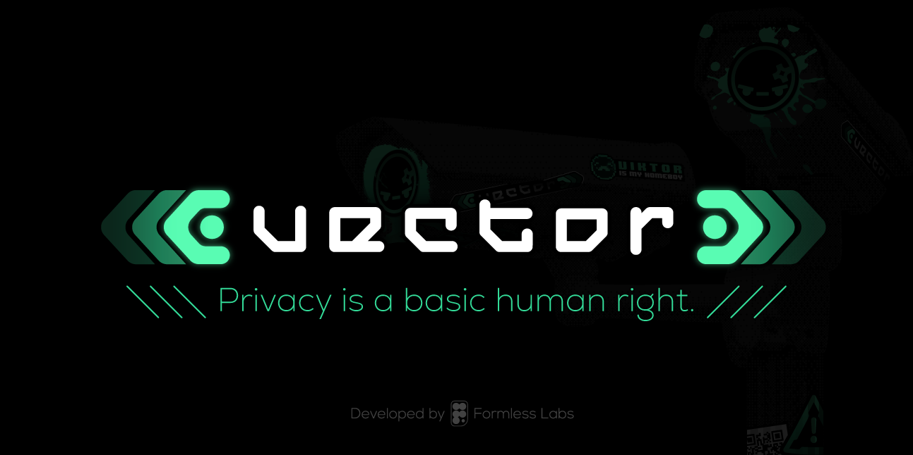
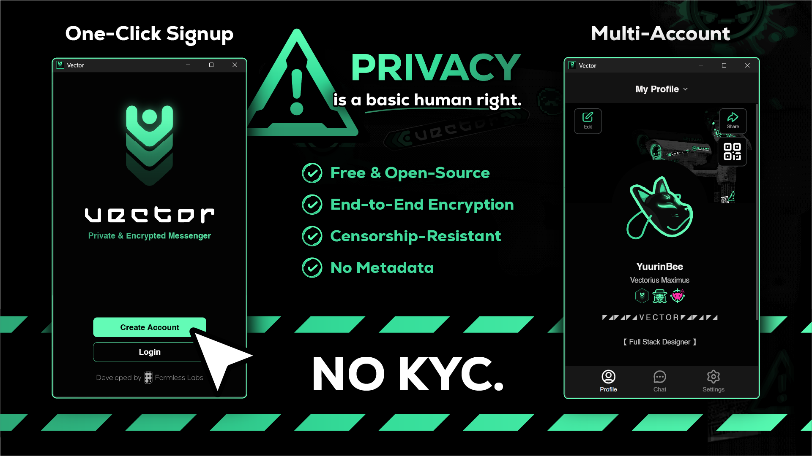
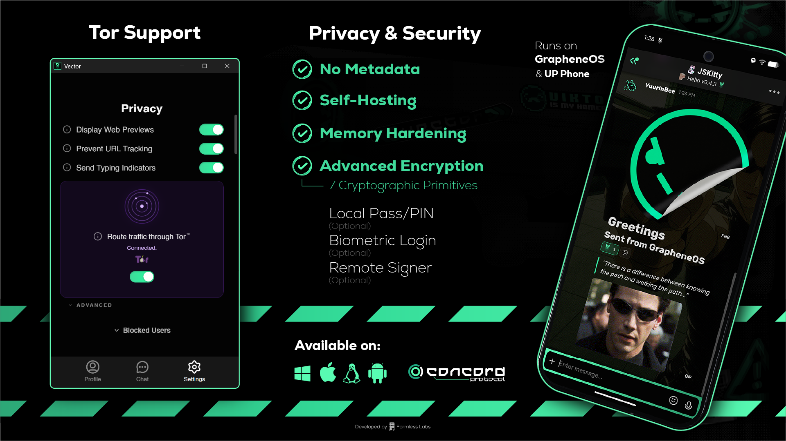
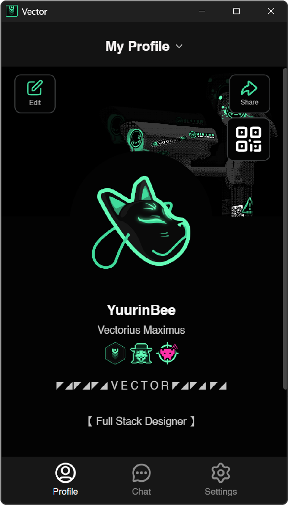
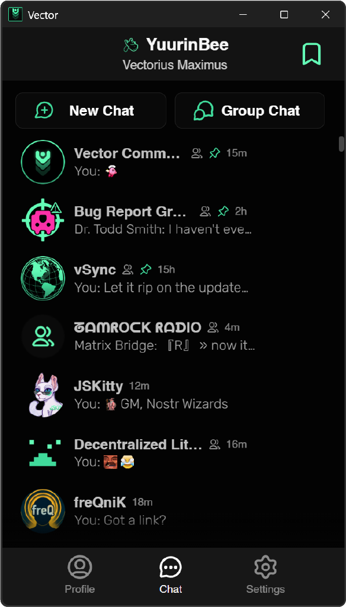
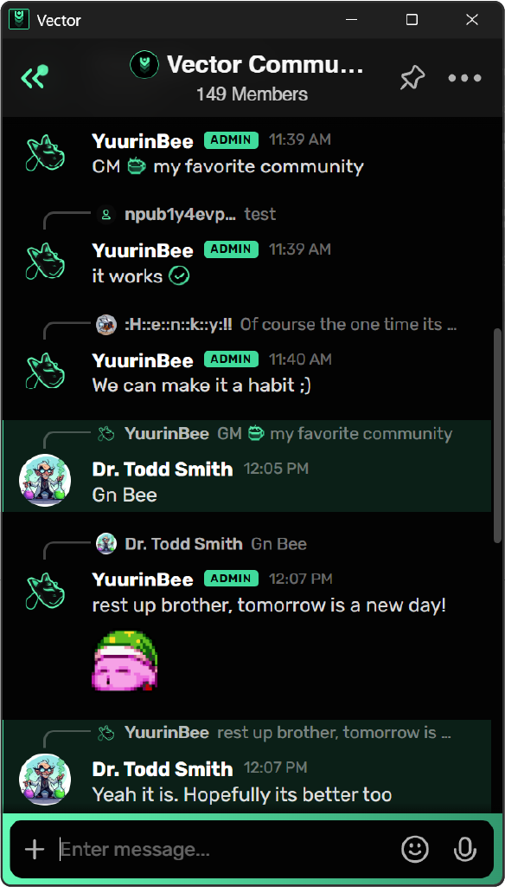

<p align="center">
  <a href="https://github.com/VectorPrivacy/Vector/releases/latest"></a>
  <a href="https://github.com/VectorPrivacy/Vector/releases/latest"></a>
  <a href="https://github.com/VectorPrivacy/Vector/releases/latest"></a>
  <a href="https://github.com/VectorPrivacy/Vector/releases/latest"></a>
  <a href="https://github.com/VectorPrivacy/Vector/releases/latest"></a>
  <a href="https://github.com/VectorPrivacy/Vector/blob/master/LICENSE"></a>
</p>

---

<h3 align="center">
  Private & Encrypted Messenger App
</h3>

<h4 align="center">
  Designed for everyone, providing a secure and private “hardline” between you and your contacts.
</h4>

---

<p align="center">
  
  
</p>

---

<p align="justify">
  Vector is a free, open-source messenger built for private communication without compromise. There's no phone number, no email, and no account to create, just download it and start talking. Your messages, files, and communities are end-to-end encrypted, and no company or server sits in the middle able to read them, sell your data, or shut you down. Vector is designed to be light and efficient, running on under 200MB of RAM, so it works well on virtually any device, including older phones and low-powered hardware. No ads. No tracking. No exceptions.
</p>

---


### Free-to-Use, Open-Source

Vector Privacy is a free messenger application that was designed for anyone around the world that seeks to protect their basic human right to privacy and wants to speak freely, without being monitored by third-parties for any intrusive reason. Vector is also open source, which means that the codebase is public and anyone can review its technical design, verify authenticity, as well as contribute to improve the overall quality for all users.

---


### No Compromise Encryption

Vector runs on [Nostr](https://nostr.com/), a decentralized relay network, so your data is never stored on a centralized server that can read it, sell it, or shut it down. Direct messages use [NIP-17](https://github.com/nostr-protocol/nips/blob/master/17.md), pairing [NIP-44 encryption](https://github.com/nostr-protocol/nips/blob/master/44.md) with [NIP-59 gift wraps](https://github.com/nostr-protocol/nips/blob/master/59.md) to protect both content and metadata. Communities run on [Concord](https://github.com/concord-protocol/concord), a protocol built for encrypted group spaces where authority is a signed roster every member verifies. Learn more about [Vector's Encryption](https://vector-privacy.gitbook.io/vector-privacy/vector-messenger/intro/encryption).

---


### No Personal Data Tracing, Breaches, & Leaks

Vector doesn’t store your personal data in a centralized cloud service or on centralized servers, thus massively reducing the risk of data leaks and private information being shared against the will of the rightful owner. By design, Vector does not possess the technical permissions or abilities to access private information of Vector users. Even Vector developers, nor Formless Labs, have access or permission to your information and data.

---

# Purpose

Vector was born out of a feeling of, for the lack of a better word; "necessity".

The messengers with all the cool features, have stark downsides: opt-in proprietary encryption (Telegram), no encryption at all (Discord), or encryption added, almost seemingly through pity, and most certainly with backdoors, to apps created by the world's largest and most anti-human tech conglomerates.

The messengers with the most sovereign, decentralised, E2E Encrypted philosophies: lack incredibly basic features, or have such an archaic and illegible User Experience, that the modern user of this century feels as if they've returned to the Stone Age; flooded with a tangled-web of bugs, a slowness familiar only to P2P software, and governance issues.

In addition to security and privacy in communication, modern software has hit a brick wall: you now need half a gig of RAM to open a simple messaging app, and the React framework plagues the entire web.

Modern software wastes Modern compute, because developers have gotten lazy, and project managers have gotten greedy.

**Vector; possibly naively, but surely bravely, aims to fill this gap.**

Powered by Passion, Built on [Nostr](https://nostr.com/).

---

# Features

### 🔐 Privacy & Security
- **No Phone Number, No Email, No KYC:** Sign up with nothing but a keypair. No identity to leak, subpoena, or sell.
- **Tor, I2P or Clearnet:** Pick the network every connection uses. Tor is built in, bridges included, and I2P runs through your own router. If your network isn't ready, Vector waits instead of quietly going direct.
- **Message Requests:** DMs from people you've never replied to wait in Requests, and nothing of theirs loads until you answer or accept.
- **Remote Signers:** Keep your keys in a separate signer via NIP-46, or Amber on Android. Your nsec never touches the app.
- **Metadata Stripped by Default:** EXIF and location data removed from every photo before it leaves your device.
- **Private Media Storage:** Media you only look at stays in memory, and the files you keep are encrypted on disk.
- **Self-Destructing Messages:** Set a per-chat timer and watch messages disappear on your own schedule.
- **Local Encryption:** Protect your account with a PIN, password, or biometrics.
- **Sealed Push Notifications:** Android and Vector Web can wake for a message while closed, and the pusher can't read it or tell who it's from.
- **Streamer Mode:** Hide the names, pictures and keys of anyone who hasn't agreed to be on stream.

### 👥 Communities & Chat
- **Encrypted Communities:** Discord-style spaces with text and voice channels, categories, and private channels, fully end-to-end encrypted.
- **Roles & Permissions:** Custom roles with per-channel overrides, timeouts, and an Audit Log of every change.
- **Bans That Actually Work:** Removing a member re-keys the room, cryptographically locking them out of everything that follows.
- **Moderation Console:** Raid detection, one-press removal of a whole wave, and rules a Community writes for itself.
- **Voice & Video Calls:** Encrypted one-to-one calls with camera and screen sharing, relayed by default so neither side learns the other's IP.
- **Voice Channels:** Drop-in voice rooms with screen and camera sharing, per-person volume, and moderator controls.
- **Rich Message Composer:** Markdown, mentions, and custom emojis render live as you type.
- **Voice Messages & Dictation:** Record audio or dictate a message, with on-device AI transcription.
- **Music & Media:** A Floating Player with synced lyrics, YouTube and SoundCloud in chat, Nostr post cards, and 3D models you can spin.
- **Multiple Accounts:** Run several identities on one install with an in-app switcher, and sign in on another device by scanning a code.

### 🖥️ Everywhere
- **Widescreen & Slim Layouts:** On a desktop-sized window, Communities sit on a rail beside the channel list, conversation and member list; phones get a layout of their own.
- **Main Menu:** Every place in the app, pinned favourites and folders, and one search over all of it.
- **In Your Browser:** Vector Web runs the full app in any modern browser, Tor Browser included, with nothing to install.
- **Native Notifications:** Desktop notifications with avatars, inline reply, and mark as read.

### 🎨 Style & Customization
- **Custom Emoji Packs:** Create, crop, and share your own packs, compatible with other Nostr clients.
- **Chat Wallpapers:** Set a custom background per conversation with live blur and brightness controls.
- **Coloured Text:** Rainbow, gradient and colour tags, plus ANSI code blocks.
- **Themes:** 7 built-in themes, including XMR and Satoshi.

### 🛠️ For Developers
- **Vector SDK:** Build bots in about a dozen lines of Rust, no protocol knowledge required.
- **Slash Commands:** Ship real commands with typed parameters through a Discord-style picker.
- **Mini Apps:** Run WebXDC apps and multiplayer games directly inside encrypted chats, found in the App Store.
- **AI Agent Support:** An MCP server gives AI agents 61 tools to drive Vector programmatically.

---

# Screenshots
<p align="center">
  
  
  
</p>

---

# Install

Download the latest release for your platform, or open Vector Web in your browser. No account, no phone number, no email required.

| Platform | Download |
|----------|----------|
| Windows | [Latest Release](https://github.com/VectorPrivacy/Vector/releases/latest) |
| macOS | [Latest Release](https://github.com/VectorPrivacy/Vector/releases/latest) |
| Linux | [Latest Release](https://github.com/VectorPrivacy/Vector/releases/latest) |
| Android | [Latest Release](https://github.com/VectorPrivacy/Vector/releases/latest) or [Zapstore](https://zapstore.dev/apps/io.vectorapp) |
| Web | [web.vectorapp.io](https://web.vectorapp.io) |

> [!NOTE]
> The Android build is a standard APK and runs on de-Googled and privacy-focused Android variants, including [GrapheneOS](https://grapheneos.org) and UP Phone.

Check any download at [vectorapp.io/verify](https://vectorapp.io/verify) before you install it: it matches the file against the hash GitHub recorded for that release. From v0.5.0, releases also carry signed checksums and build attestations.

Prefer to build from source? See [Compiling](#compiling) below.

---

# Compiling

> [!NOTE]
> For any additional help or questions, visit the official [GitBook](https://docs.vectorapp.io) or join the [Vector Community on Vector](https://chat.vectorapp.io) or [Vector Community Discord](https://discord.gg/ar2pnE9Huy).

### Build Guides

| Platform | Guide |
|----------|-------|
| Ubuntu / Debian | [docs/build/ubuntu.md](docs/build/ubuntu.md) |
| macOS → Android | [docs/build/macos-android.md](docs/build/macos-android.md) |
| Your OS missing? | [Contribute a guide!](docs/build/) |

### Vector Web

```bash
npm run web:build              # wasm core + frontend → dist-web/ (add `-- --release` for production)
npm run web:serve              # http://localhost:8790
```

Needs `wasm-pack` and the `wasm32-unknown-unknown` target; see [web/README.md](web/README.md) for how it fits together and how to host it.

---

# Bare Builds

Vector supports "bare builds," a minimal compilation mode that excludes optional features for enhanced security and performance. While not the recommended experience for most users, bare builds are hardened, faster, and lighter, at the expense of more complex and "glamorous" features.

### Why Use Bare Builds?

- **Reduced Attack Surface**: Fewer dependencies & less code means fewer potential vulnerabilities.
- **Resource Efficiency**: Lower memory and CPU usage, with faster boot time.
- **True Minimalism**: A powerful app, with only the core necessities.

### Building Vector Bare

```bash
# Development bare build
npm run dev:bare

# Production bare build
npm run build:bare
```

### What's Excluded?

Currently, bare builds exclude:
- Vector Voice AI: Whisper transcription and dictation, and its GPU ML dependencies, like Vulkan.
- Tor routing (the embedded `arti` onion-routing client).
- I2P routing (Vector's SAM client for your own I2P router).
- Video compression (the statically linked FFmpeg that macOS and Windows releases carry).

### Standard vs Bare

- **Standard Build**: Full suite of features, maximum utility and range of function.
- **Bare Build**: Core functionality only, maximum efficiency and the smallest dependency tree.

The bare build suits users who put a minimal footprint and performance ahead of features like Local AI and in-app Tor or I2P routing. A bare build connects over Clearnet only, so network privacy can still come from a system-level Tor or VPN setup.

---

# Resources

Explore the official Vector website, documentation, and developer resources below.

- [Website](https://vectorapp.io)
- [GitBook](https://docs.vectorapp.io)
- [Vector SDK](https://vector-privacy.gitbook.io/vector-privacy/vector-sdk)
- [Vector Hub](https://vectorapp.io/hub)
- [Privacy Policy](https://vectorapp.io/privacy-policy)

## Socials

Follow the channels below for the latest on development, releases, and community updates.

- [Vector Blog](https://vectorapp.io/blog)
- [X/Twitter](https://x.com/vectorprivacy)
- [Vector Community](https://chat.vectorapp.io)
- [Discord](https://discord.gg/ar2pnE9Huy)

<sub>⚠️ Always verify the authenticity of links before clicking.</sub>

---

# Donate

Vector is free, open-source, and funded entirely by donations. No ads, no tokens, no venture capital.

| Currency | Address |
|----------|---------|
| Monero (XMR) | `47ENi8rwDxqNYNoCnGhGGGLaE2YbA6B9DVXgUbiewyM1F6G4fFGGGK31Am9RqTz2WddDKoeNwaZSufR9seT7knQ44UPjHF8` |
| Bitcoin (BTC) | `bc1q70zhkfuej2cl9nhrxwqcnvrzpwm9kqtrth3tmc` |
| Ethereum (ETH) | `0x20CF19c23fC747C6E88Fee9Adb2d7F5C0Dc59892` |

<sub>*The ETH wallet supports all EVM-compatible chains and tokens.*</sub>

If you're interested in donating in a way that isn't listed above, see our [Donations page](https://vector-privacy.gitbook.io/vector-privacy/vector-messenger/more/donations).

<sub>⚠️ Always verify donation addresses against the [official Donations page](https://vector-privacy.gitbook.io/vector-privacy/vector-messenger/more/donations) before sending.</sub>

---

## Attributions

Vector uses third-party assets and resources. For a complete list of attributions and licenses, please see our [Attributions](docs/attributions.md) document.

---
## License

Vector is released under the [MIT License](LICENSE).

You are free to use, copy, modify, merge, publish, distribute, sublicense, and build upon this project for any purpose, commercial or personal, as long as the original license notice is included. This project is provided as-is, without warranty of any kind.

---

**Trademark notice:** This license covers the source code only. The Vector
name, logo, and branding are trademarks of Formless Labs and are not
licensed under the MIT License above. See [TRADEMARK.md](TRADEMARK.md).

